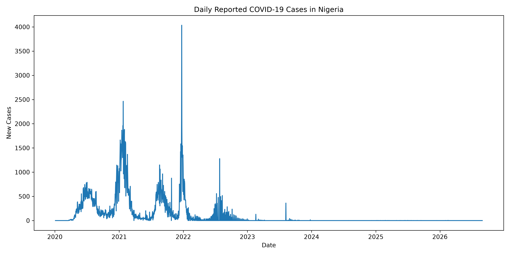
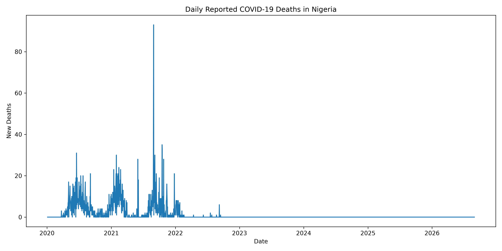
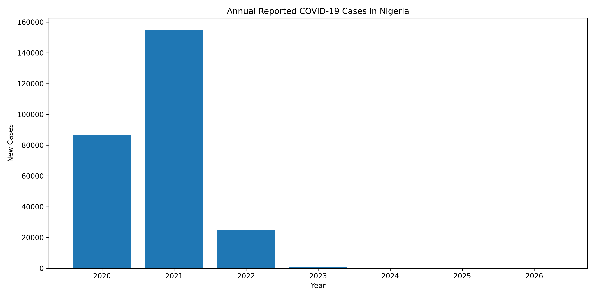

# Group 3: Infectious-Disease Surveillance Pipeline (Nigeria COVID-19)

An Apache Airflow data-engineering pipeline that extracts Nigeria's records from the Our World in Data (OWID) COVID-19 dataset, validates and cleans them, loads them into SQLite, produces surveillance summaries, and evaluates next-day case forecasting with time-series cross-validation.

**Authors:** <add group member names here>

## Pipeline

The DAG `group3_surveillance_pipeline` (`dags/surveillance_pipeline.py`) has eight tasks:

1. `extract_nigeria`: filters the OWID file to Nigeria
2. `validate_data`: required columns and duplicate-date checks
3. `clean_data`: drops rows with missing case or death fields
4. `data_quality_assessment`: writes `data/data_quality_report.csv`
5. `load_to_database`: loads the clean data into SQLite (`data/surveillance.db`)
6. `analysis`: runs `analysis.py` (summary tables and charts)
7. `feature_engineering`: runs `src/feature_engineering.py` (lagged, rolling and next-day target features)
8. `predictive_modeling`: runs `scripts/tune_rf_timeseries.py`

`scripts/task_timing.py` reads task durations from the Airflow metadata database for the pipeline-evaluation chapter.

## Repository layout

    dags/        Airflow DAG
    src/         Feature engineering
    scripts/     Random Forest tuning, task timing
    analysis.py  Surveillance summaries and charts
    data/        Selected result files (large and generated data are git-ignored)

## Setup

Requires Python 3.12.

    python3 -m venv airflow-venv
    source airflow-venv/bin/activate
    pip install -r requirements.txt

Download the OWID COVID-19 dataset (`owid-covid-data.csv`) from https://github.com/owid/covid-19-data and save it as `data/owid_covid_data.csv`. Point Airflow's `dags_folder` at this repository's `dags/` directory, then run:

    airflow dags test group3_surveillance_pipeline

## Results

Clean dataset: 2,431 daily records, 2020-01-04 to 2026-08-30.

| Metric | Value |
| --- | --- |
| Cumulative confirmed cases | 267,237 |
| Cumulative reported deaths | 3,155 |
| Peak daily new cases | 4,035 (2021-12-23) |
| Peak daily new deaths | 93 (2021-08-30) |
| Case fatality ratio | 1.18% |

## Forecasting evaluation

Target: next-day new cases. Validation: `TimeSeriesSplit(n_splits=5, gap=7)`; hyperparameters are selected on folds 1-3 and performance is reported on folds 4-5 (holdout).

| Model | Holdout MAE | Holdout RMSE |
| --- | --- | --- |
| Predict zero | 0.061 | 0.351 |
| 7-day mean | 0.113 | 0.359 |
| Baseline random forest | 10.026 | 11.182 |
| Tuned baseline random forest | 9.866 | 9.877 |
| Feature-engineered random forest | 2.087 | 16.326 |
| Tuned feature-engineered random forest | 1.353 | 4.626 |

Full results are in `data/rf_tuning_final.csv`.

### Limitations

Feature engineering and tuning clearly improved the random forest, but **both simple benchmarks outperform every random forest on the holdout folds**. Reported cases are close to zero in the later years, which favours a predict-zero forecast. These results do not show that the random forest is the best forecaster for this series.

## Data source

Our World in Data COVID-19 dataset. Please follow OWID's licence and citation requirements.
